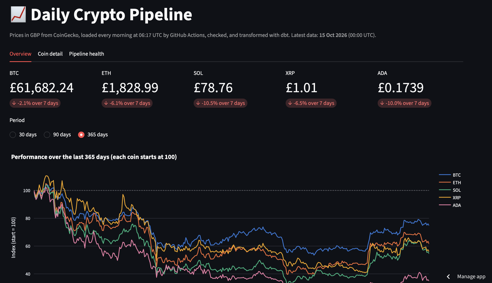
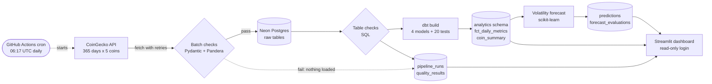
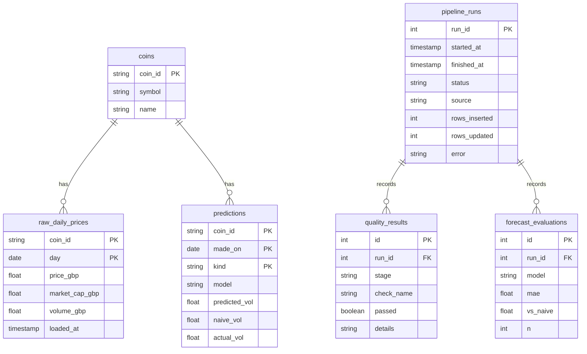
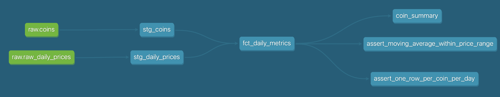
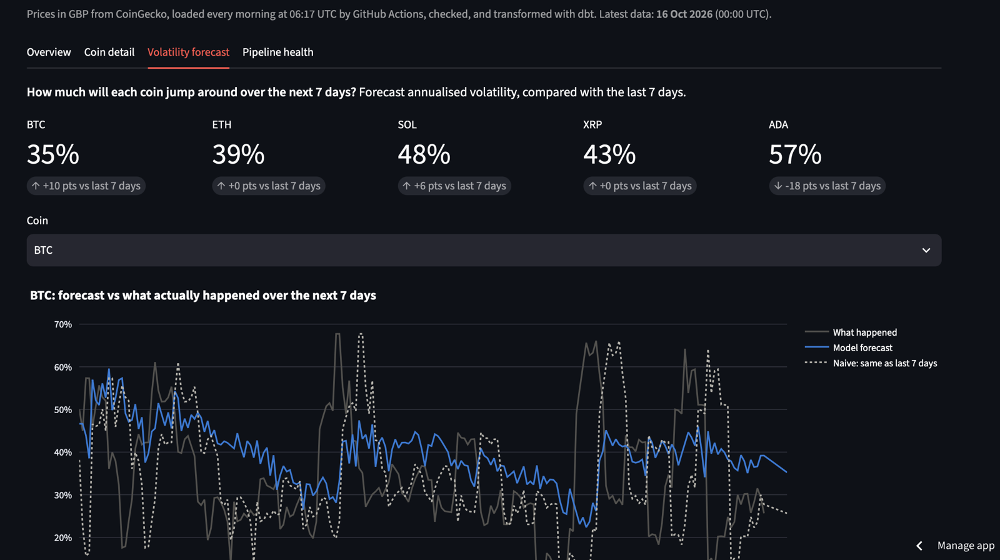

# Daily Crypto Data Pipeline

[](https://github.com/mhamad1213/crypto-pipeline/actions/workflows/ci.yml)
[](https://github.com/mhamad1213/crypto-pipeline/actions/workflows/daily.yml)

An end-to-end data pipeline that runs by itself every morning. It fetches a year of daily
prices for 5 cryptocurrencies from the CoinGecko API, validates them, loads them into
PostgreSQL, transforms them with dbt, forecasts next week's volatility for each coin, and
publishes everything on a live dashboard.

**Live dashboard:** https://mhamad-crypto-pipeline.streamlit.app



## At a glance

| | |
|---|---|
| **Data** | BTC, ETH, SOL, XRP, ADA in GBP: 365 days each, about 1,825 rows, plus one new day every morning |
| **Schedule** | GitHub Actions cron, every day at 06:17 UTC, no server to keep running |
| **Quality** | 3 layers of checks (Pandera before loading, SQL after loading, 20 dbt tests after transforming), and every result is logged |
| **Forecast** | Next-7-day volatility, **24.7% lower error than a naive baseline** in a walk-forward test over 1,045 forecasts |
| **Tests** | 61 pytest tests, run on every push against a real Postgres |
| **Stack** | Python 3.12, Pydantic, Pandera, SQLAlchemy, PostgreSQL (Neon), dbt, Prefect, scikit-learn, Streamlit, Plotly, GitHub Actions, Docker |

## Architecture



Every step from the API call to the forecast runs inside one **Prefect flow**
(`src/crypto_pipeline/flow.py`), started each morning by **GitHub Actions**
(`.github/workflows/daily.yml`). The database is **Neon** (serverless Postgres, free tier).
The dashboard is hosted on **Streamlit Community Cloud** and connects with a login that can
only `SELECT`.

## How a daily run works

1. **06:17 UTC:** GitHub starts the `Daily pipeline` workflow on a fresh Ubuntu machine.
   It installs the project and checks the two secrets (`COINGECKO_API_KEY`,
   `DATABASE_URL`) are set. A `concurrency` group makes sure two runs never write at once.
   GitHub can start scheduled jobs late when it is busy, which is fine for a daily job.
2. **Extract:** one Prefect task per coin calls CoinGecko for the last 365 days. The client
   retries rate limits and server errors itself, and Prefect retries the whole task after
   30 s and 2 min. A wrong API key or unknown coin is *not* retried, because waiting won't
   fix it. The raw JSON is saved and uploaded as a workflow artifact for 30 days.
3. **Batch checks:** Pydantic parses each data point, and a Pandera schema checks the batch.
   If anything fails, **nothing is loaded** and the run is marked failed.
4. **Load:** an idempotent upsert (`INSERT ... ON CONFLICT DO UPDATE`). Re-running a day
   never creates duplicates. A normal run inserts 5 new rows and refreshes the rest.
5. **Table checks:** SQL checks that every coin is present, no day is missing and the data
   is fresh.
6. **Transform:** `dbt build` rebuilds the models and runs their tests.
7. **Forecast:** re-runs the walk-forward evaluation, saves today's forecast for each coin,
   and fills in what actually happened for forecasts made 7 days ago.
8. **Log:** the run's status, row counts and every check result go into `pipeline_runs`
   and `quality_results`, which the dashboard's *Pipeline health* tab shows.

Any failure turns the workflow red and GitHub sends a failure email. The dashboard also
shows a warning if there has been no successful run for 36 hours.

## Data model



**Raw layer (`public` schema, written by Python):** the tables above. `(coin_id, day)` is
the primary key of `raw_daily_prices`, which is what makes the load idempotent.

**Analytics layer (`analytics` schema, built by dbt):**



| Model | Type | What it holds |
|---|---|---|
| `stg_coins`, `stg_daily_prices` | views | Cleaned, renamed copies of the raw tables |
| `fct_daily_metrics` | table | One row per coin per day: daily and log returns, 7 and 30-day moving averages, 7 and 30-day volatility (and annualised ×√365), running peak and drawdown, all with window functions |
| `coin_summary` | table | One row per coin: latest price, 7 and 30-day returns, volatility, current and worst drawdown |

## Data quality

| Layer | When | Checks | On failure |
|---|---|---|---|
| **Batch** (Pydantic + Pandera) | before loading | known coin, price > 0, market cap and volume ≥ 0, one row per coin per day, no daily move over 50% | nothing is loaded |
| **Table** (SQL) | after loading | all 5 coins present, no missing days (`generate_series`), latest day is today or yesterday | run marked failed |
| **dbt tests** | after transforming | 20 tests: unique and not-null keys, relationships, value ranges (a custom `between` test), one row per coin per day, moving average within the price range | run marked failed |
| **Source freshness** | on demand | `dbt source freshness` warns after 36 h, errors after 72 h | warning |

The 50% limit was chosen from the data. The biggest real daily move in the year was XRP's
−20.6% on 6 Feb 2026, so the limit leaves more than 2× headroom while still catching
broken data, such as a price in the wrong currency.

## Volatility forecast

**The question:** how much will each coin's price move about over the next 7 days?
Predicting the *price* is close to impossible. Predicting *volatility* is not, because
calm weeks tend to follow calm weeks and wild weeks follow wild weeks.

- **Target:** the standard deviation of the next 7 daily log returns, annualised (×√365).
- **Baseline (naive):** next week's volatility = last week's volatility.
- **Model (HAR):** a Ridge regression on the logs of 1-day, 7-day and 30-day volatility,
  a classic finance model that blends a short, medium and long memory.
  Gradient boosting with extra features was also tested.
- **Evaluation:** walk-forward. The first 120 days are training only. Then the model is
  retrained every 30 days on the past and scored on the next 30. Training rows must be at
  least 7 days older than the test block (an **embargo**), because each row's target looks
  7 days ahead and would otherwise leak test answers into training. A test checks this.

**Results on the real data** (1,645 labelled coin-days, 15 Nov 2025 to 9 Oct 2026):

| Model | Mean absolute error | vs naive |
|---|---|---|
| Naive: same as last 7 days | 22.7 pts | baseline |
| **HAR (Ridge), used in production** | **17.1 pts** | **−24.7%** |
| Gradient boosting | 19.4 pts | −14.4% |

The simpler model wins. With about 1,600 examples, gradient boosting has more freedom than
the data can support. The naive forecast loses mainly because it reacts to every spike a
week late, while HAR pulls forecasts back towards each coin's longer-term level.

Every run saves two kinds of rows in `predictions`. **Backtest** rows (the walk-forward
test) are rebuilt each time. **Live** rows are written once per coin per day and never
changed, except that `actual_vol` is filled in once the 7 days have happened. That builds
an honest track record nobody can quietly edit.



## Dashboard

Four tabs, built with Streamlit and Plotly:
- **Overview:** latest prices, 7-day change, the performance of all coins rebased to 100,
  and a summary table.
- **Coin detail:** price with moving averages, volatility and drawdown for one coin.
- **Volatility forecast:** next week's forecasts, model vs naive vs what happened, and the
  evaluation table.
- **Pipeline health:** last run, hours since the last success, checks passed and run history.

Queries are cached for 10 minutes. The app connects as `dashboard_reader`, a Postgres role
that can only `SELECT` (`scripts/create_dashboard_reader.py`). Default privileges give it
read access to the tables dbt rebuilds every morning.

## Run it locally

You need Python 3.12 and Docker.

```bash
git clone https://github.com/mhamad1213/crypto-pipeline.git
cd crypto-pipeline
docker compose up -d
python -m venv .venv
source .venv/bin/activate
pip install -r requirements.txt -r dashboard/requirements.txt
pip install -e .
cp .env.example .env
```

Put a free CoinGecko Demo API key in `.env`, then:

```bash
python -m pytest
python -m crypto_pipeline.flow
python -m crypto_pipeline.forecast
streamlit run dashboard/app.py
```

`pytest` runs the 61 tests, `flow` runs the whole pipeline into the local database,
`forecast` prints the model-vs-baseline report, and the dashboard opens on
http://localhost:8501. Add `--from-raw` to the flow to reuse the saved JSON instead of
calling the API.

The repo has two requirements files on purpose: `requirements.txt` is the full pipeline,
and `dashboard/requirements.txt` is the small set Streamlit Cloud installs. Streamlit
Cloud logs a "more than one requirements file" note and correctly uses the dashboard one.

## Project structure

```
.github/workflows/   ci.yml (lint, dbt parse, tests) and daily.yml (the scheduled run)
src/crypto_pipeline/
  coingecko.py       API client with retries
  extract.py         API JSON -> validated daily rows, saves the raw JSON
  models.py          Pydantic model for one daily price
  quality.py         Pandera batch checks and SQL table checks
  db.py, load.py     tables, idempotent upsert, run logging
  flow.py            the Prefect flow that ties it together
  forecast.py        features, walk-forward evaluation, saving forecasts
  config.py          coins, settings, DATABASE_URL handling
transform/           dbt project: staging views, marts, tests
dashboard/           Streamlit app (app.py) and its SQL (queries.py)
scripts/             create_dashboard_reader.py
tests/               61 tests (database tests run in throwaway schemas)
docs/                screenshots used in this README
```

## Design decisions

- **GitHub Actions instead of a scheduler server:** a daily batch job doesn't need an
  always-on machine. Prefect still provides retries, task structure and logging.
- **ELT with dbt:** load the raw data first, then transform in SQL. The raw data is kept,
  and every metric is versioned, tested and documented.
- **Idempotent everywhere:** price upserts, insert-once live forecasts and dbt rebuilds
  mean any step can be re-run safely.
- **Fail loudly and early:** bad batches never reach the database, and every check result
  is stored, not just printed.
- **Least privilege:** the public dashboard can read data but not change it. Secrets live
  only in the GitHub and Streamlit secret stores.

## Possible next steps

- More coins, or hourly data, with incremental dbt models.
- Alerts to Slack or email from the flow itself.
- Prediction intervals for the volatility forecast, and a GARCH model as another benchmark.
